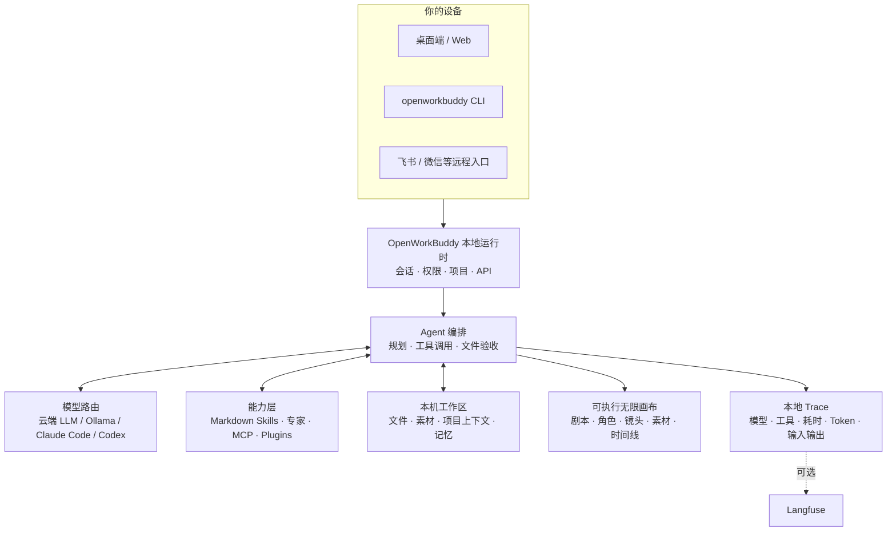
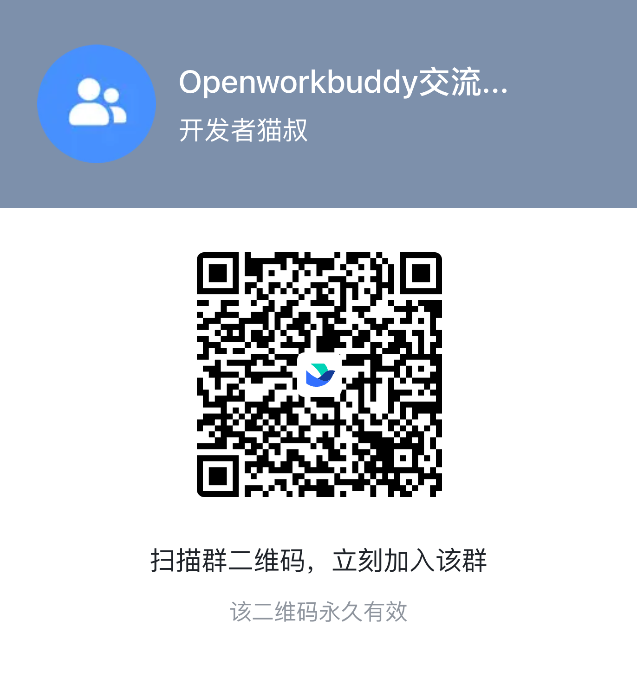

<p align="center"></p>
<h1 align="center">OpenWorkBuddy</h1>
<p align="center"><b>本机优先的 AI 办公工作台，把你的资料和要求变成可打开、可修改的文件。</b><br>
给经常做周报、PPT、表格和文档的人，也给需要自托管的团队。<br>
使用你选择的模型，查看执行过程，在成果区核对交付文件。</p>
<p align="center"><a href="#quick-start"><b>▶ 做一份项目汇报 PPT</b></a> · <a href="https://github.com/CatCatUncle/openworkbuddy/releases">下载安装包</a> · <a href="https://catcatuncle.github.io/openworkbuddy/zh/?utm_source=github&amp;utm_medium=readme&amp;utm_campaign=first_result">项目网站</a> · <a href="#文档">文档</a> · <a href="README.en.md">English</a></p>
<p align="center"><a href="https://github.com/CatCatUncle/openworkbuddy/releases"></a> <a href="LICENSE"></a> <a href="https://github.com/CatCatUncle/openworkbuddy/stargazers"></a></p>
<p align="center"><sub>个人非商用、学校和公益机构免费；公司及个人商用须获 <a href="COMMERCIAL-LICENSE.md">商业授权</a>。模型与媒体服务的费用由所选服务商决定。</sub></p>
<p align="center"><br><sub>界面流程演示；首次成功耗时按下面的任务实测。</sub></p>

---

<a id="quick-start"></a>
<a id="三分钟跑起来"></a>
## 快速开始：做一份项目汇报 PPT

**前置条件**：一台能运行应用的电脑，以及一个可用的模型服务、已安装的本地模型或已登录的本机 CLI。用 API 时需要自己的 Key。本例用文字和简洁图形生成 PPT，不需要生图、视频、消息渠道或额外连接器；准备 PowerPoint、WPS 或 LibreOffice，方便下载后打开检查。

1. **安装并启动。** macOS / Windows 在 [Releases](https://github.com/CatCatUncle/openworkbuddy/releases) 选择适合芯片的安装包：Windows 安装版 `*-win-setup.exe`，免安装版 `*-win-x64-portable.exe` / `*-win-arm64-portable.exe`；macOS 用 `.dmg`。Linux 用下方源码方式或 [Docker 部署](docs/部署.md)。
2. **连接模型。** 首次启动注册账号；在「设置 → 模型」选择服务商、填写准确型号和 API 地址、添加 Key，再测试连接。已有本机 CLI 的用户也可在「设置 → 智能体」选择它。
3. **复制任务，打开结果。** 选择 Craft 执行模式，粘贴下面的任务。完成后在「成果文件」预览或下载 `project-update.pptx`，用演示软件打开核对四页内容，再试一句“把第 4 页的下周计划改成两列表格，保留其他页”。

```text
请做一份 4 页的项目汇报 PPT，保存为 project-update.pptx。
汇报对象：项目负责人。项目：示例网站上线。
第 1 页｜封面：示例网站上线——项目进展汇报。
第 2 页｜本周完成：上线产品页；修复移动端菜单。
第 3 页｜当前进展：正在补充用户指南。
第 4 页｜下周计划：完成英文版；收集 5 条试用反馈。
要求：16:9、中文、简洁商务风；正文使用可编辑文本，
每页一个重点、字号适合投屏、无文字溢出；保留原始事实，不补造数据。
写完确认文件存在，并在成果区提供可打开的文件。
```

**成功标准**：磁盘上有非空的 `project-update.pptx`；PowerPoint、WPS 或 LibreOffice 能打开，四页内容与输入一致、文字可编辑、排版无溢出；第二次要求能更新同一份文件的第 4 页。看到聊天回复或“安装完成”，都还未达到这次任务的成功标准。可复制的任务文件：[中文](examples/quick-start/task.md) / [English](examples/quick-start/task.en.md)。

**计时方式**：从开始安装计到首次打开且核对通过，分别记录下载、启动、模型配置和任务等待。“三分钟”是优化目标，实际时间取决于网络、模型准备情况和任务执行，当前没有发布实测成功率。

<details>
<summary><b>从源码运行：Node.js 18+、npm 与 Git</b></summary>

```bash
git clone https://github.com/CatCatUncle/openworkbuddy.git
cd openworkbuddy
npm ci
npm start
```

看到服务已启动后，打开 <http://localhost:3800>，继续上面的第 2、3 步。桌面开发模式用 `npm run app`。开发时数据默认在仓库的数据目录；安装包的数据默认在 `~/OpenWorkBuddy`。完整说明见 [安装与启动](docs/安装与启动.md)。

</details>

### 卡住时先看这里

| 卡在哪 | 下一步 |
|---|---|
| 系统阻止首次打开 | 按 [安装与启动](docs/安装与启动.md) 对应系统的说明处理 |
| `npm ci` 在 Electron 下载处失败 | 核对网络与 Node 版本，查看 [源码启动排错](docs/安装与启动.md#启动时容易卡住的几件事) |
| 服务启动报端口占用 | macOS / Linux 用 `PORT=3801 npm start`；Windows cmd 用 `set PORT=3801 && npm start`，打开新端口 |
| 测试连接失败，或任务报上游错误 | 核对服务商的 API 地址、型号、Key 和额度，见 [模型配置](docs/配置模型.md) |
| 任务在等批准或答复 | 查看输入框上方的审批卡或收件箱，处理后继续 |
| 回复说完成但找不到文件 | 确认当前项目，在成果区和工作目录核对文件；让助理检查 `project-update.pptx`，不要直接把这次计作成功 |

跑通后再试 [核心场景](#你说一句它交给你)，或阅读 [用户指南](https://catcatuncle.github.io/openworkbuddy/zh/guides/user.html)。觉得有用可以 Star 收藏；要收到新版本通知，设置 **Watch → Custom → Releases**。

字号、主题和显示密度可在「头像菜单 → 外观」调整。

<details open>
<summary><b>第一次打开被系统拦住</b></summary>

当前 macOS 发行包使用本地签名，尚未通过 Apple 公证。请使用本仓库 Releases 的安装包。

- **macOS「无法验证」**：如你选择继续安装，先关闭提示，进入 **系统设置 → 隐私与安全性 → 仍要打开**，按系统要求确认。[Apple 操作说明](https://support.apple.com/guide/mac-help/open-a-mac-app-from-an-unknown-developer-mh40616/mac)。
- **macOS「已损坏」**：先重新下载；仍打不开时按[安装与启动](docs/安装与启动.md)检查签名与启动日志，不能只按「无法验证」处理。
- **Windows**：核对下载来源后，在 SmartScreen 选择「更多信息 → 仍要运行」。
- **双击没反应**：查看 `~/OpenWorkBuddy/logs/boot.log`，见[双击了没反应](docs/安装与启动.md#双击了没反应)。

</details>

## 你说一句，它交给你

| 你说一句 | 它交给你 |
|---|---|
| 帮我出一份 Q3 复盘 PPT，数据用这个 Excel | 读表 → 算 → 一个能直接放的 `.pptx` |
| 调研国内 AI 陪伴产品，出一份报告 | 联网搜 → 逐个打开读 → Markdown / Word |
| 把这份材料做成手机上能看的网页 | 写 HTML → 起本机服务 → 扫码就能看（[成品](https://hunan-travel.pages.dev/)） |
| 每天 9 点抓行业新闻，做成晨报发我飞书 | 定时任务 + IM 推送，错过了会补跑 |
| 做个 30 秒产品宣传片，竖版横版各一份 | 填表挑时长、画幅、声音 → 配音、动效、合成 → `.mp4` |

<p align="center">
 
</p>

> [!NOTE]
> 多任务并行、目标验收、👍👎 进自进化、双层记忆、权限档位、IM 远程指挥、桌面宠物…… 全部能力见 **[功能清单](docs/功能清单.md)**。

## 为什么是它

<table>
<tr>
<td width="50%" valign="top">

<b>📄 文件是真的。</b>

PPT / Word / Excel / 网页都真生成，成果面板里点开就能验收。交付后在成果区和磁盘上核对实际文件。

</td>
<td width="50%" valign="top">

<b>🔌 模型随便换，东西全在你手里。</b>

DeepSeek / 通义 / 智谱 / Kimi / OpenRouter / Ollama 界面点一下就切；本机装了 <b>Claude Code / Codex</b> 的，一键拿它当发动机，不用另买 token。配置与成果文件留在本机，默认只听 <code>127.0.0.1</code>；云模型和远程连接器会收到完成任务所需的数据。

</td>
</tr>
<tr>
<td width="50%" valign="top">

<b>🧩 加个能力 = 丢一个 Markdown 文件。</b>

存成 <code>skills/&lt;名字&gt;/skill.md</code>，存盘后下一条任务就生效——不改代码、不重启、不打包。

</td>
<td width="50%" valign="top">

<b>🔍 也适合拿来读懂 Agent。</b>

模型路由、工具调用、文件验收、记忆、权限、本地 Trace 全在同一个仓库里：一条真实任务，从它为什么这么做到最后交了什么，你都看得见。

</td>
</tr>
</table>

<details>
<summary><b>📣 想推荐给别人？这段直接复制</b></summary>

```text
OpenWorkBuddy：开源的 AI 办公助理，跑在自己电脑上。
说一句话，它自己规划、动手、验收，交给你能打开的 PPT / Word / Excel / 网页，不是一段聊天记录。
· 模型随便换：DeepSeek、通义、Kimi、智谱、Ollama，本机的 Claude Code / Codex 也能直接当发动机
· 数据全在本机，默认只听 127.0.0.1；也能放服务器给团队用，每个人绑自己的微信、飞书
· 加个能力 = 丢一个 Markdown 文件
适合：天天做 PPT、周报、调研报告的人；想私有化部署 AI 助理的团队；想读懂 Agent 怎么搭的开发者。
个人非商用免费：https://github.com/CatCatUncle/openworkbuddy
```

</details>

## 长这样

**「同一个人，换四个场景，手里举块写着字的牌子——要像随手拍的，别像 AI 图」**

<p align="center">
 
</p>

难的不是画人，是四张里得是同一个人、牌子上的中文不能糊。它先出一张，再用看图工具真去读自己刚生的那张（不是凭记忆吹），确认了才照这个方向铺开其余三张。

**「做个湖南旅游攻略网站，14 个市州一个都不能少」**

<p align="center">
 <a href="https://hunan-travel.pages.dev/"></a>
</p>

**<https://hunan-travel.pages.dev/>** —— 点开就能逛。一个 HTML 加一个图片文件夹，不挂任何外部 CDN，扔到静态托管上就是一个站。这不是截图拼的示意图，是它交出来的那份东西本身。

**「我要去北京玩三天，给我做一个旅游规划，用地图组件」**

<p align="center">
 
</p>

<p align="center">
 
</p>

<p align="center">
 
</p>

回答里的行程直接画成一张行程卡：按天切换，地图上按顺序标好每个地点，右边是带照片的地点卡片。点「打开路线」，这一天的几站按顺序整条带进地图，站名和卡上一样；国内默认用高德打开，旁边能换成 Google（上面第二张就是），国外开 Google 地图；「发到手机」出二维码，扫了在手机上接着走。右上角切到「时间线」，一天从上午排到晚上。不填 Key 也能用；在 设置 → 地图 填了高德 Key，国内地点更准。

**「每天早上七点，把今天的天气和该注意的事发到我飞书」**

<p align="center">
 
</p>

一句话排出来的定时任务，人不在电脑前也照跑；每趟调了哪些工具、为什么这么说，都在「自动化 → 运行记录」里点得开。飞书 / 企微 / 钉钉 / Telegram 同一条路。

怎么做到的、本机 Claude Code 当发动机长什么样 → **[三个案例，拆开讲](docs/案例.md)**

## AI 短剧无限画布

剧本、角色、场景、分镜、参考图、视频、配音、时间线摆在同一张图上。连线不是装饰——它表示下一步生成真会去读的角色、首帧和声音。改哪个镜头，只有那个镜头重跑。

<p align="center">
 
</p>

**一句话做出来的 AI 短剧**：说一句「做一集《不烧心》竖屏短剧」，剧本、定妆、分镜、首帧、镜头视频、成片一路做到底，下面这集 75 秒就是这么出来的（点封面看成片）。

<p align="center">
 <a href="docs/videos/ai-short-drama-ep01.mp4"></a>
</p>

左侧点「无限画布」就能开始。空白处拖拽平移，`Shift`+拖拽框选，`Shift`/`⌘` 点节点加选减选，底部对话框里能 `@` 引用任意节点和素材。

## 放服务器给团队用：多人、私有化部署

```bash
git clone https://github.com/CatCatUncle/openworkbuddy.git && cd openworkbuddy
bash deploy.sh --domain buddy.example.com # Docker + 自动 HTTPS
```

多租户、席位、额度、离职一键收权限都有。**起来先注册管理员**——第一个注册的就是超管。
→ [部署](docs/部署.md) · [运维手册](deploy/README.md) · [多人协作](docs/多人协作.md) · [账号与部署运维](docs/账号与部署运维.md)

## 配模型：DeepSeek / 通义 / Kimi / Ollama / Claude Code / Codex

**设置 → 模型**，挑预设（OpenAI / Anthropic / OpenRouter / DeepSeek / 通义 / 智谱 / Kimi / 火山方舟 / Ollama），粘 Key，保存即生效。生图、配音、生视频另有一张表。对照表 → [配置模型](docs/配置模型.md)

> [!IMPORTANT]
> Key 只存在 `config.json`，已在 `.gitignore` 里，别手滑提交。

## 命令行也能用

`openworkbuddy` 跟桌面版**共用同一份**配置、技能、记忆、连接器和会话——终端里起的活儿，手机和网页上看得见、插得上话；桌面上做到一半，终端里 `openworkbuddy resume` 接着往下走。

默认简洁显示，只保留当前进度、最终回答和本轮实际成果。`/details` 看工具过程，`/usage` 看用量，`/verbose on` 展开详情。生成网页后说“给我打开啊”，会直接交给本机程序打开；也可用 `/open 1` 或 `/open 子目录/index.html`。

```bash
npm link # 一次性：装成全局命令（也可以直接 node cli.js …）

openworkbuddy "帮我写一份本周周报" # 单发：跑完就退
openworkbuddy # 交互：连续对话，打一个 / 出命令菜单
cat error.log | openworkbuddy "这是什么问题" # 管道：管道内容当材料送进去
openworkbuddy -q "生成本周周报" > 周报.md # 文件里只有周报，没有进度条

openworkbuddy engines use claude-code # 换执行引擎：跑在你已经付过钱的订阅上，不烧 API 额度
```

单发和管道模式下**不会**反问你，脚本和 cron 里不会卡住。退出码说实话：`0` 成功、`1` 任务失败、`2` 参数写错、`130` Ctrl+C，所以 `openworkbuddy doctor && npm start` 拦得住没配好的机器。

`sessions` / `resume` / `engines` / `doctor` / `pair`（扫码把手机连上来）/ `worktree`，以及 `--mode` `--perm` `-C` `-f` `--json` 等全部参数 → **[命令行用法](docs/命令行用法.md)**

## 它是怎么搭的



这张图也是读代码的路线：从 `server.js` 进去，再看 `src/agent/agent.js` 怎么编排模型和工具。细节 → [实现细节](docs/实现细节.md)，代码怎么分层 → [代码架构](docs/代码架构.md)

## 最新动态

- **10-19** 网页预览默认铺满右侧面板，交互画布按真实视口运行；需要查看整页时可手动切换适配
- **10-17** CLI 默认简洁显示，过程与用量按需查看；修复空插话、旧文件重复列出和补充要求丢失，支持直接打开本会话成果
- **10-16** 修复网页预览中小游戏和按钮点不动的问题；支持独立临时存储，保留应用数据隔离
- **10-16** OAuth 第二期：HTTP 连接器在服务商页面授权，令牌自动刷新，可移除本机授权
- **10-16** 预览支持圈选批注，文件改动能逐块回退、撤销，并按行提出修改要求
- **10-16** 团队任务使用组织共享模型和连接器，费用与个人任务分别记录；浏览器录制可生成技能草稿
- **10-16** 英文界面新增漏翻检查，用户原文不翻译；官网提供中英文用户和开发者指南

- **10-16** 任务可生成组织内只读链接，本人随时撤回；分享设置在页面里，单人模式隐藏
- **10-16** 快速开始提前，附可复制的 PPT 任务、文件核对标准和故障排查；采用指标标明缺失
- **10-15** 执行计划在页面内折叠展开，随对话滚动；更新进度时保留展开状态和焦点
- **10-15** 顶栏新增收件箱：待审批和待答复优先，接着是出错、运行中和未读任务；独立定时任务的完成结果也会出现，点开可看完整执行过程
- **10-15** 定时任务按创建方式归还结果：在对话里安排的任务把结论写回原对话，独立安排的任务留在收件箱；会话关联只在服务端保存，不通过列表接口暴露
- **10-15** 历史按日期分组，标记产出文件；行菜单支持改名、移项目和未读标记，任务与文件均可置顶
- **10-15** 审批卡支持 Esc 拒绝和主修饰键 + Enter 单次放行；⌘N 新建任务、⌘K 搜索任务，输入框下方会提示 AI 可能出错
- **10-15** 任务历史能置顶：点图钉放进最上面的「已置顶」，换台电脑也在
- **10-15** 自进化里点「采纳」不再整页刷新；自进化、智能体页打开不用再等几秒
- **10-14** 每个账号都能绑自己的微信、飞书、QQ、企微、公众号、群机器人和邮箱：消息按本人跑，结果只推给本人
- **10-14** 多人服务器上成员有自己的那份：模型渠道按需共享、能填自己的 Key，能建自己的专家，能起自己的助理名字和偏好
- **10-14** 文件名里带顿号的附件不再被拆成两个不存在的文件
- **10-13** 注册能直接填邮箱：自动取 @ 前面那段当用户名，登录时填邮箱也认；注册失败不再算进限流，填错不会被锁
- **10-13** 设置 → 安全 新增「沙箱安全」开关：关掉后 AI 能动工作目录外的文件、连本机和内网；多个账号共用时关不了
- **10-13** 「本机/内网放行」支持通配符：192.168.1.*:* 放一整个网段，*.local:8080 放一类主机名
- **10-12** 扫码连的个人微信收得到定时任务和提醒了；跑任务时照样收消息、「停」当场生效，处理时显示「对方正在输入」
- **10-12** 本机 Codex / Claude Code 读得到随消息传的文件了：粘贴的文字、图和文档都附上完整路径，不再只收到文件名
- **10-10** 成员、审计员和分公司账号也能建多个项目：一个项目一个文件夹，都在自己的工作目录里，以前的成果在「默认项目」
- **10-10** 画布卡片能拖线连到另一张卡，连不上的标红说原因；点「+」接一张已连好的新卡，标题和提示词能直接在卡上改

更早的看 **[变更记录](CHANGELOG.md)**。

## ⚠️ 这个 agent 手里有 shell

它能跑命令、读写文件、上网，所以有命令审批、文件黑名单、URL 白名单、审计日志和四档权限；macOS 和 Windows 上，它跑的命令还套一层系统沙箱，读不到 Key 和账本。装别人的技能前会先过一遍静态体检，危险的默认不装——但它不是杀毒，装前自己读一眼 `skill.md`。
**放公网前先读 [安全](docs/安全.md)**，默认配置只为本机调。

## 交流群

用崩了、有想法、想一起改，进飞书群直接说：

<p align="center">
 
</p>

## 一起把它做下去

- **用崩了、卡住了，开个 [issue](https://github.com/CatCatUncle/openworkbuddy/issues/new)**，哪怕只贴一句报错——你以为「只有我遇到」的坑，多半所有人都在踩。贴之前扫一眼，别把 API Key 带上。
- **10 分钟** 写个技能：一个 Markdown 存成 `skills/<名字>/skill.md`，存盘即生效，[模板在这](CONTRIBUTING.md#提交一个技能3-分钟)
- **一晚上** 挑个 issue 改：`npm install && npm start` 就跑起来，`npm test` 不用 API Key 也能全绿

项目结构、测试、PR 规范都在 [参与贡献](CONTRIBUTING.md)。不用先开 issue 问，直接发 PR。

## 商用授权 · 企业服务

> [!IMPORTANT]
> **个人非商用、学校公益免费；公司使用（哪怕只在内部用）和个人商用，必须买商业授权。**
> 公司可以免费试用 30 天（前提是还没用在实际业务上），长期用必须买。
> **[联系维护者](https://github.com/CatCatUncle)**，写清楚公司、怎么用、大概多少人用，我们尽快回你。细则见 [COMMERCIAL-LICENSE.md](COMMERCIAL-LICENSE.md)。

| 你的情况 | 要不要买授权 |
|---|---|
| 个人非商用：自用、学习、研究、业余项目 | 免费 |
| 学校、科研机构、公益组织、政府机构 | 免费 |
| 公司评估试用：最长 30 天，还没用在实际业务上 | 免费 |
| 公司 / 团队用在实际业务里，**哪怕只在内部** | **必须买** |
| **个人商用**：个人接单、给客户干活、做付费产品或服务 | **必须买** |
| 做 SaaS 对外服务、打包售卖、给客户交付 / 外包 / 定制 | **必须买** |

买授权不解锁任何功能：只有这一份代码，没有功能锁、不倒计时，授权不联网验证。软件不向作者或任何第三方回传使用数据；检查更新时会去 GitHub Releases 查有没有新版（GitHub 能看到本机 IP）。
没授权就商用，权利人可以依法追究民事责任；未经许可删改版权声明，还可能单独构成侵权——依据和判例见 [未授权商用的法律后果](COMMERCIAL-LICENSE.md#未授权商用的法律后果)。

除了授权，我们还承接企业 AI 业务：

| 服务 | 做什么 |
|---|---|
| **企业 FDE（驻场工程）** | 工程师进你们团队，把 Agent 接进真实业务流程，跑起来再交接 |
| **AI 培训** | 企业内训，让团队把 AI 用进日常工作，不停在尝鲜 |
| **AI 落地咨询** | 挑场景、定方案、算成本；私有化部署、行业智能体都能谈 |

作者是前大厂 Agent 工程师，服务过跨境电商、制造业、AI 初创、私募金融机构、消费品巨头、国央企等客户。常驻深圳，欢迎来交流和考察。

📮 合作联系：**[联系维护者](https://github.com/CatCatUncle)**

## 从别家换过来：Claude Cowork、Codex、豆包办公的开源替代

在找 **Claude Cowork、Codex、豆包办公、千问办公的开源替代**，或者想给 **DeepSeek 找一个 agent 外壳（harness）**？每一家都写了一页老实对比，也写了什么时候还是用它更合适：

| 你在用 / 在找 | 对比页 |
|---|---|
| Claude Cowork | [Claude Cowork 开源替代：本机运行、模型随便换](https://catcatuncle.github.io/openworkbuddy/zh/alternatives/claude-cowork/) |
| Codex | [Codex 办公版替代：交付的是文件，还能拿 Codex 当发动机](https://catcatuncle.github.io/openworkbuddy/zh/alternatives/codex/) |
| 豆包办公 | [豆包办公开源替代：也能用豆包模型](https://catcatuncle.github.io/openworkbuddy/zh/alternatives/doubao/) |
| 千问办公 | [千问办公开源替代：通义模型照样用](https://catcatuncle.github.io/openworkbuddy/zh/alternatives/qwen/) |
| DeepSeek | [DeepSeek agent 外壳：填上 Key 就能干活](https://catcatuncle.github.io/openworkbuddy/zh/alternatives/deepseek-agent/) |

OpenWorkBuddy 是独立开源项目，跟上面这些公司都没有关联。

## 文档

首次成功的试用流程、计时口径与缺失指标 → [采用与反馈](docs/采用与反馈.md)。

在线文档：**[用户指南](https://catcatuncle.github.io/openworkbuddy/zh/guides/user.html)** · **[开发者指南](https://catcatuncle.github.io/openworkbuddy/zh/guides/developer.html)** · [中英文项目网站](https://catcatuncle.github.io/openworkbuddy/zh/)

| 文档 | 一句话 | 文档 | 一句话 |
|---|---|---|---|
| [功能清单](docs/功能清单.md) | 全部能力、技能与工具 | [部署](docs/部署.md) | 服务器 / Docker / 反代 |
| [案例](docs/案例.md) | 上面那几张图怎么做出来的 | [多人协作](docs/多人协作.md) | 多租户、账号、权限、额度 |
| [安装与启动](docs/安装与启动.md) | 安装包、源码、常见卡壳 | [安全](docs/安全.md) | 审批闸门、黑白名单、审计 |
| [配置模型](docs/配置模型.md) | 各家 base_url / 模型名对照 | [数据同步与搬家](docs/数据同步与搬家.md) | 数据存哪、换电脑怎么搬 |
| [命令行用法](docs/命令行用法.md) | CLI 参数、管道、`--json`、cron | [开源与商业版边界](docs/开源与商业版边界.md) | 买授权到底买到什么 |
| [扩展](docs/扩展.md) | 写技能、接 MCP、装插件、建专家 | [路线图](docs/路线图.md) | 接下来做什么、怎么算做完 |
| [IM 与定时任务](docs/IM与定时任务.md) | 飞书 / QQ / 企微 / 微信 / 钉钉 | [变更记录](CHANGELOG.md) | 一句话一条，最新在上 |
| [实现细节](docs/实现细节.md) | agent 主循环怎么转的 | [参与贡献](CONTRIBUTING.md) | 项目结构、测试、提 PR |
| [安全基线](docs/安全基线.md) | 数据落在哪、谁看得见、哪些没做到 | [远程访问](docs/远程访问.md) | 手机/外网连本机，两个开关默认关着 |
| [账号与部署运维](docs/账号与部署运维.md) | 开号、离职、找回密码、备份升级、带几家组织 | [代码架构](docs/代码架构.md) | 代码分几层、谁能引谁、新代码放哪 |

## 同一个作者的其他项目

- **[toolward](https://github.com/CatCatUncle/toolward)** —— 给 agent 用的技能 / MCP 连接器静态安检：37 条规则分六族，零运行时依赖。`npm i -g toolward` 装上，OpenWorkBuddy 自动把它当第二把尺子用，不装也完全不影响。同样是 PolyForm Noncommercial。

## 协议

**个人非商用、学校公益免费；公司使用（哪怕只在内部）和个人商用要买商业授权**，公司可先免费试用 30 天。购买请[联系维护者](https://github.com/CatCatUncle)。

协议 [PolyForm Noncommercial 1.0.0](LICENSE)，细则和没授权商用的后果见 [COMMERCIAL-LICENSE.md](COMMERCIAL-LICENSE.md)。部署配置、脚本、技能模板另按 MIT（[清单](COMMERCIAL-LICENSE.md#按-mit-授权的部分)）；名称和图标不在授权范围内。

复制或分发本软件的任何部分，都要带上协议全文（或网址）和 [LICENSE](LICENSE) 开头所有以 `Required Notice:` 开头的行。

官方发布只有 GitHub 上的 CatCatUncle/openworkbuddy 及其 Releases。非官方渠道的安装包不由作者提供更新和支持，使用者的授权以 PolyForm Noncommercial 1.0.0 的条件和商业授权为准。

**KylinWork 等项目未经作者许可拿本项目代码二次开发，还擅自改了开源协议，作者已要求其全网下架。**

Copyright (c) 2026 开发者猫叔 (DeveloperCatUncle)

## 免责声明

独立开源项目，与腾讯及其 WorkBuddy 产品无任何关联，不含其代码或素材；对接的 IM 均走公开接口。借鉴来源见 [NOTICE.md](NOTICE.md)。有问题请开 [Issue](https://github.com/CatCatUncle/openworkbuddy/issues)。

## 支持这个项目

<p align="center">
 <a href="https://github.com/CatCatUncle/openworkbuddy">
 
 </a>
</p>

<p align="center">
 <a href="https://github.com/CatCatUncle/openworkbuddy"></a>
</p>

<p align="center">
 <sub>顺手把它转给一个天天手搓 PPT、周报、会议纪要的同事，比一百次曝光管用。</sub>
</p>

## 贡献者

感谢每一个动手改过这个项目的人。想加入他们：[参与贡献](CONTRIBUTING.md)。

<p align="center">
<a href="https://github.com/CatCatUncle/openworkbuddy/graphs/contributors">
 
</a>
</p>

## Star 历史

<p align="center">
<a href="https://star-history.com/#CatCatUncle/openworkbuddy&Date">
 <picture>
 <source media="(prefers-color-scheme: dark)" srcset="https://api.star-history.com/svg?repos=CatCatUncle/openworkbuddy&type=Date&theme=dark">
 
 </picture>
</a>
</p>
